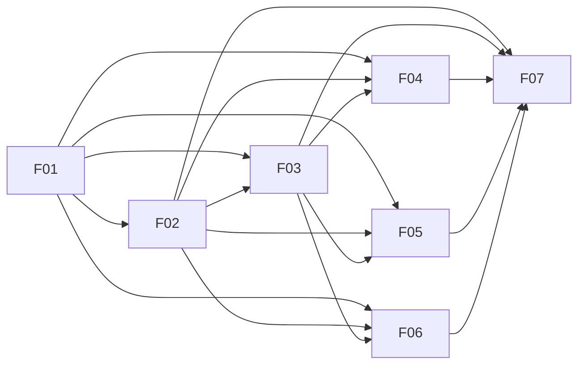

# PRD — Catraca (MVP)

> Fonte: brief da fundadora (regras R01–R13, gateway simulado e contrato fixo da API de parceiros).
> Este PRD é o mapa que todo agente consome. Toda feature tem ID, o que **provê**, o que **consome**,
> critérios de aceite próprios (`Fxx-ACyy`) e, para cada aresta do grafo, ao menos um critério
> cross-feature (`Xnn`) que prova que o que uma feature provê chega e funciona na que consome.

## 1. Visão

A Catraca vende ingressos para eventos pequenos. Visitantes veem a vitrine, participantes compram e
veem seus ingressos, organizadores (contas da seed) criam e operam os próprios eventos, e parceiros
vendem pela API com chave. O pagamento passa por um gateway externo assíncrono (simulado no modo padrão).

A lição da primeira tentativa: cada feature funcionava sozinha e quebrava ao encontrar as outras.
Por isso as regras que atravessam features (vagas, status do ingresso, cancelamento, painel) têm
**um único dono** e são **consumidas**, nunca reimplementadas:

| Conceito | Dono | Quem consome |
|---|---|---|
| Status de evento (`draft`/`published`/`cancelled`) e "evento à venda" | F02 | F03, F04, F05, F06, F07 |
| Vagas ocupadas/disponíveis (R05) e compra atômica (R07) | F03 | F04, F05, F06, F07 |
| Transições de status do ingresso (R06, R08, R11) | F03 (compra/gateway) e F07 (cancelamento) | F04, F05, F06 |
| Sessão, papéis e acesso (R13) | F01 (sessão/papel) e F02 (dono do evento) | todas as telas |

## 2. Personas

- **Visitante** — sem login; vê a vitrine.
- **Participante** — cria conta (nome, e-mail, senha), entra, sai, compra e vê "Meus ingressos".
- **Organizador** — vem da seed; cria e opera os próprios eventos.
- **Parceiro** — sistema externo; usa a API com `X-Api-Key`.

## 3. Features

| ID | Nome | Provê | Consome |
|---|---|---|---|
| F01 | Plataforma, contas e harness | App Node em Docker, Postgres, migrações, seed idempotente, sessão por cookie, `currentUser`, middlewares `requireOrganizer`/`requireParticipant`, cadastro/login/logout, chave de parceiro em config, comandos up/down/gates | — |
| F02 | Eventos do organizador | Tabela `events`, CRUD com validação R01, publicação R02, página de gestão `/organizer/events/:id` (R04), `getOwnedEvent(orgId, eventId)` (R13), `isOnSale(event)`, `listOnSaleEvents()`, ponto de extensão da página de gestão (slots de check-in e painel) | F01 |
| F03 | Compra e gateway simulado | Tabela `tickets`, `purchaseTicket({eventId, channel, buyerUserId?, buyerEmail, cardNumber})` atômica (R05–R07), `seats(eventId)`, código único (R09), gateway simulado + worker assíncrono (R08) com guarda `WHERE status='pending'`, `GATEWAY_DELAY_SCALE` | F01, F02 |
| F04 | Vitrine e Meus ingressos | `/` (vitrine), `/events/:id` (detalhe + compra), `/my-tickets` | F01, F02, F03 |
| F05 | API de parceiros | `GET /api/partner/events`, `POST /api/partner/events/:id/purchases`, `GET /api/partner/tickets/:id`, middleware de chave | F01, F02, F03 |
| F06 | Check-in e painel | `POST /organizer/events/:id/checkin` (R10), painel na página de gestão (R12), `panelMetrics(eventId)` | F01, F02, F03 |
| F07 | Cancelamento de evento | `POST /organizer/events/:id/cancel`, `cancelEvent(orgId, eventId)` transacional (R11) | F02, F03, F04, F05, F06 |

## 4. Grafo de dependências

Seta `A --> B` = "B consome o que A provê". Cada aresta tem um critério `Xnn` (seção 6).

## 5. Waves

| Wave | Features | Modo | Por quê |
|---|---|---|---|
| W1 | F01 | sequencial | base de tudo (banco, sessão, harness) |
| W2 | F02 | sequencial | evento é pré-requisito de compra |
| W3 | F03 | sequencial | núcleo de vagas e gateway, consumido por todos os canais |
| **W4** | **F04, F05, F06** | **paralela** (3 worktrees, 3 PRs) | só consomem F01–F03; não dependem entre si |
| W5 | F07 | sequencial | atravessa vitrine, API, check-in e painel — precisa de todos prontos |

Regra de ouro do handoff: uma feature só começa quando todas as que ela consome estão `done` no
`docs/state.json` (último relatório aprovado). Na W4 as três começam juntas.

## 6. Critérios de aceite

Formato: `ID` (regras) descrição. Todos verificáveis por comando ou efeito observável.

### F01 — Plataforma, contas e harness

- **F01-AC01** Em um clone limpo, `npm run up` sobe o produto em `http://localhost:3000` com a seed carregada, sem nenhum outro passo.
- **F01-AC02** `npm run down` encerra tudo: nenhuma porta do produto responde e nenhum container do projeto fica rodando; `npm run up` de novo funciona, inclusive a seed (idempotente).
- **F01-AC03** `npm run gates` roda as verificações de artefatos e os testes automatizados e passa.
- **F01-AC04** A seed cria organizador A, organizador B e um participante, com as credenciais do README.
- **F01-AC05** (R13) Participante cria conta (nome, e-mail, senha) em `/signup`, entra em `/login`, sai em `/logout`; e-mail duplicado é rejeitado.
- **F01-AC06** (R13) Visitante em `/organizer` é redirecionado ao login; participante logado recebe 403 sem dados.
- **F01-AC07** O modo padrão usa o gateway simulado sem nenhuma chave de pagamento.

### F02 — Eventos do organizador

- **F02-AC01** (R01) Criar evento com nome, data/hora, local, lotação ≥ 1 e preço > 0 funciona; lotação 0, preço 0 ou campo vazio é rejeitado com 422.
- **F02-AC02** (R01) Data de início no passado é rejeitada ao criar e ao editar.
- **F02-AC03** (R02) Evento nasce rascunho; só após publicar passa a `published`.
- **F02-AC04** (R03, R05) Reduzir a lotação abaixo das vagas ocupadas é rejeitado; aumentar é aceito.
- **F02-AC05** (R04) Cada evento tem página de gestão própria em `/organizer/events/:id` com editar e publicar.
- **F02-AC06** (R13) Organizador B não vê o evento de A na lista `/organizer` nem por `/organizer/events/:id` (404 sem nome, números ou ingressos).

### F03 — Compra e gateway simulado

- **F03-AC01** (R06) A compra cria um ingresso `pending`, ocupa vaga e é respondida sem esperar o gateway (< 1 s).
- **F03-AC02** (R05) Vagas disponíveis = lotação − (pendentes + confirmados); em evento cancelado, 0.
- **F03-AC03** (R07) Sem vaga, a compra é recusada com erro `sold_out`; sob 30 compras simultâneas em evento de lotação 5, exatamente 5 são aceitas, repetidamente.
- **F03-AC04** (R08) Final 0001 confirma em 2–5 s; 0002 recusa em 2–5 s; 0003 confirma em 30–40 s; 0004 recusa em 30–40 s; outro final recusa em 2–5 s. Recusa libera a vaga.
- **F03-AC05** (R09) Cada ingresso tem código único de 8 caracteres.
- **F03-AC06** (R06) Cartão sem 16 dígitos é rejeitado antes de criar ingresso.
- **F03-AC07** (R03, R12) O ingresso grava o preço vigente no momento da compra.

### F04 — Vitrine e Meus ingressos

- **F04-AC01** (R02) A vitrine `/` lista só eventos publicados e não cancelados, para visitante deslogado.
- **F04-AC02** (R06, R08, R09) Participante compra em `/events/:id` com o cartão 0001; em "Meus ingressos" aparece pendente e, em até 5 s (recarregando), confirmado, com evento e código.
- **F04-AC03** (R07) Sem vaga, `/events/:id` exibe **Ingressos esgotados** no lugar da compra, e uma tentativa de compra responde com **Ingressos esgotados**.
- **F04-AC04** Visitante que tenta comprar é levado ao login.

### F05 — API de parceiros

- **F05-AC01** As três rotas seguem o contrato fixo (campos, status HTTP, códigos de erro).
- **F05-AC02** Sem `X-Api-Key` ou com chave inválida, as três rotas respondem 401 `{"error":"unauthorized"}`.
- **F05-AC03** (R06) Erros da compra na ordem: 422 `invalid_request` → 404 `event_not_available` → 409 `sold_out`.
- **F05-AC04** (R02) A listagem mostra só eventos publicados e não cancelados.
- **F05-AC05** Ingresso inexistente responde 404 `ticket_not_found`.

### F06 — Check-in e painel

- **F06-AC01** (R10) O check-in exibe exatamente: **Ingresso inválido para este evento**, **Evento cancelado**, **Ingresso não confirmado**, **Ingresso já utilizado**, **Entrada liberada**, na ordem de prioridade do brief.
- **F06-AC02** (R10) Dois check-ins simultâneos do mesmo código resultam em um **Entrada liberada** e um **Ingresso já utilizado**.
- **F06-AC03** (R12) O painel mostra Confirmados, Pendentes, Check-ins, Vagas disponíveis, Receita (R$ x,yy) e Estornados conforme as definições do brief.
- **F06-AC04** (R04, R13) Check-in e painel existem só na página de gestão do dono do evento.

### F07 — Cancelamento de evento

- **F07-AC01** (R11) O organizador cancela um evento publicado; rascunho não pode ser cancelado (fora de escopo: o brief só fala em publicado).
- **F07-AC02** (R11) O cancelamento é irreversível: evento cancelado não pode ser editado nem republicado.
- **F07-AC03** (R11) Em até 10 s, confirmados viram `refunded` e pendentes viram `cancelled`.
- **F07-AC04** (R11) Resposta do gateway que chega depois do cancelamento não muda o status de nenhum ingresso.

### Critérios cross-feature (um ou mais por aresta)

| ID | Aresta | Regras | Critério |
|---|---|---|---|
| **X01** | F01 → F02 | R13 | O organizador A da seed faz login, cria um evento em `/organizer` e esse evento fica vinculado a ele (aparece só na lista de A). |
| **X02** | F01 → F03 | R06, R08 | Depois de `npm run up` (sem passo extra), o worker do gateway está ativo: uma compra com cartão 0001 confirma em até 5 s. |
| **X03** | F02 → F03 | R02, R03 | Compra em rascunho é recusada como `event_not_available`; após publicar, é aceita; após mudar o preço, a compra seguinte grava o preço novo e a anterior mantém o antigo. |
| **X04** | F01 → F04 | R09 | Uma conta criada em `/signup` compra na vitrine e vê o ingresso em `/my-tickets`; outro participante não vê esse ingresso. |
| **X05** | F02 → F04 | R02 | Evento criado pela F02 não aparece na vitrine como rascunho e aparece depois de publicado. |
| **X06** | F03 → F04 | R05, R07, R08 | A vaga ocupada por uma compra pendente (de qualquer canal) faz a vitrine exibir **Ingressos esgotados** até a recusa do gateway liberá-la. |
| **X07** | F01 → F05 | — | A chave de parceiro configurada pela F01 (e documentada no README) é aceita; qualquer outra resulta em 401. |
| **X08** | F02 → F05 | R02, R05 | A listagem da API reflete publicação e lotação da F02: rascunho ausente, publicado presente com `availableSeats` = lotação e `priceCents` corretos. |
| **X09** | F03 → F05 | R06, R07, R08 | Compra pela API responde 202 `pending`, a consulta passa a `confirmed`/`declined` pelo gateway, e 30 compras simultâneas em lotação 5 dão 5×202 e 25×409, em duas rodadas. |
| **X10** | F01 → F06 | R13 | Check-in e painel exigem sessão de organizador: visitante é redirecionado ao login e participante recebe 403. |
| **X11** | F02 → F06 | R04, R13 | O painel e o check-in aparecem na página de gestão do evento; organizador B, ao abrir o endereço da página de A, não vê números nem ingressos, e código de evento de B no check-in de A é **Ingresso inválido para este evento**. |
| **X12** | F03 → F06 | R03, R10, R12 | O painel conta vendas da vitrine e da API; a Receita usa o preço gravado em cada compra (R$ 350,00 no fluxo do avaliador); ingresso confirmado comprado pela API libera entrada. |
| **X13** | F02 → F07 | R11 | Depois de cancelado, editar ou republicar o evento é rejeitado e a página de gestão não oferece edição. |
| **X14** | F03 → F07 | R11 | Com um ingresso pendente (cartão 0003) e um confirmado (0001), cancelar leva a `cancelled` e `refunded` em até 10 s, e 45 s após a compra pendente ela continua `cancelled`. |
| **X15** | F04 → F07 | R02, R11 | O evento cancelado some da vitrine e `/events/:id` não vende mais. |
| **X16** | F05 → F07 | R11 | O evento cancelado some da listagem da API, a compra responde 404 `event_not_available` e a consulta dos ingressos mostra `refunded`/`cancelled`. |
| **X17** | F06 → F07 | R05, R10, R12 | No evento cancelado o check-in mostra **Evento cancelado** e o painel mostra Confirmados 0, Pendentes 0, Check-ins 0, Vagas 0, Receita R$ 0,00 e Estornados = nº de confirmados antes do cancelamento. |

### Rastreabilidade das regras

| Regra | Critérios |
|---|---|
| R01 | F02-AC01, F02-AC02 |
| R02 | F02-AC03, F04-AC01, F05-AC04, X03, X05, X08, X15 |
| R03 | F02-AC04, F03-AC07, X03, X12 |
| R04 | F02-AC05, F06-AC04, X11 |
| R05 | F02-AC04, F03-AC02, X06, X08, X17 |
| R06 | F03-AC01, F03-AC06, F04-AC02, F05-AC03, X02, X09 |
| R07 | F03-AC03, F04-AC03, X06, X09 |
| R08 | F03-AC04, F04-AC02, X02, X06, X09 |
| R09 | F03-AC05, F04-AC02, X04 |
| R10 | F06-AC01, F06-AC02, X12, X17 |
| R11 | F07-AC01..F07-AC04, X13, X14, X15, X16 |
| R12 | F03-AC07, F06-AC03, X12, X17 |
| R13 | F01-AC05, F01-AC06, F02-AC06, F06-AC04, X01, X10, X11 |

## 7. Fora de escopo

- Deploy e qualquer ambiente além do local.
- Gateway de pagamento real, e-mail e notificações.
- App mobile e qualidade visual (HTML simples renderizado no servidor).
- Cadastro de organizador pelo produto (só seed).
- Mais de um ingresso por compra, mapa de assentos, cancelamento ou transferência pelo participante.
- Atualização em tempo real (recarregar a página basta).
- Fuso horário configurável: tudo em `America/Sao_Paulo` (−03:00).
- Cancelar evento em rascunho, despublicar evento, excluir evento.
- Proteção CSRF, recuperação de senha, rate limiting.
